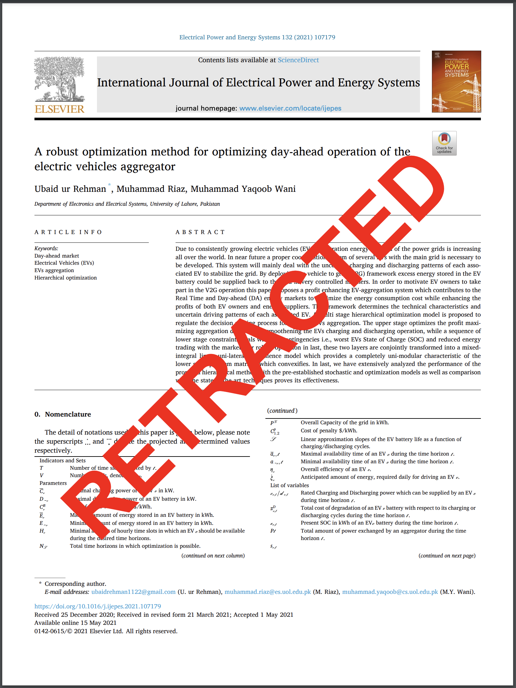
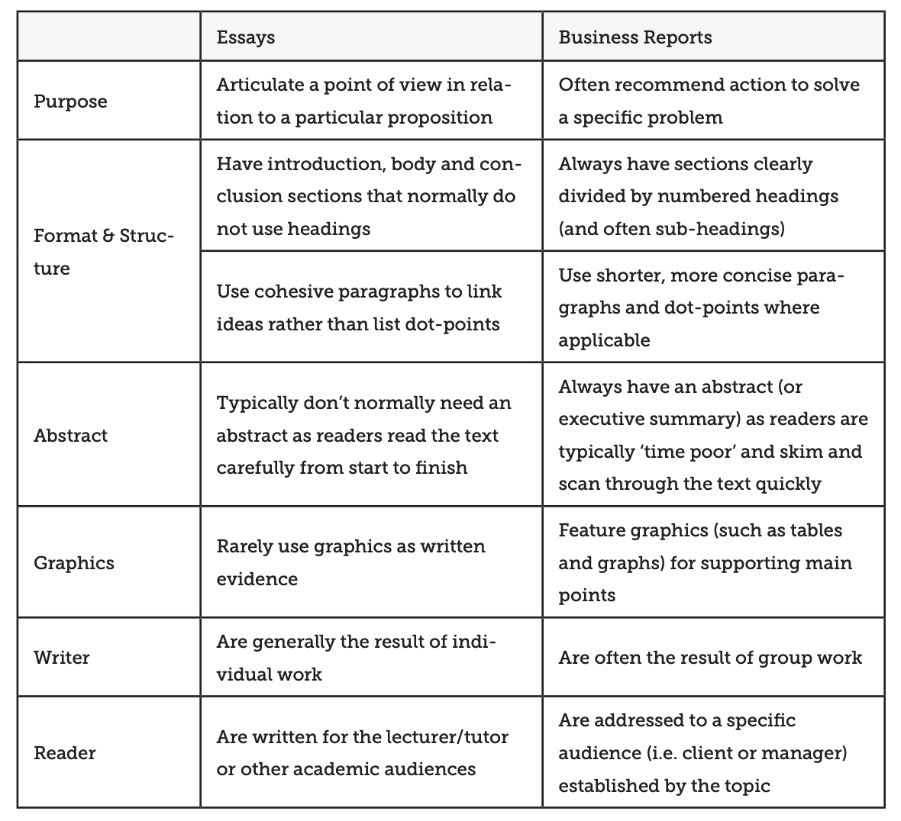

```{r}
#| label: setup
#| include: false

# Put your libraries and dataset loading code here.
```



# Assignment instructions

As we have learned in this class, academic progress includes lots of papers that are of questionable validity. Sites like [Data Colada](https://datacolada.org) and [Retraction Watch](https://retractionwatch.com) help investigate and track various forms of academic dishonesty. Formally, when a paper is found to contain serious problems, the publisher of the paper will formally retract the paper, meaning the academic journal no longer stands by the validity of the paper.  

Retraction Watch has developed a database on retracted papers, helpfully cleaned by Kaggle user [Abdurrahman Hakan Acar](https://www.kaggle.com/datasets/abdurrahmanhakanacar/global-academic-retractions-20002025). Some papers are retracted for non-fraud related reasons while others are retracted due to probable academic dishonesty. Imagine you are preparing a report for Retraction Watch on the state of academic paper retractions. Some key questions to consider:

1. What kinds of papers are most commonly retracted? Does this differ between non-fraud and fraud-based retractions?
2. Most importantly, what do you think predicts the $days_to_retraction$ variable? You will need to develop a regression model for this, including at least the variables $author_count$ and the age of the article (a variable you will need to create based on $original_paper_date$.
3. As a bonus you need to at least briefly consider whether trends in retracted papers have changed over time.

To generate the age of the paper variable, you will need to use the `lubridate` library as discussed [here](https://lubridate.tidyverse.org/). 

As we have discussed in class, setting expectations is also important. In the literature review/expectations section, discuss what patterns you expect to see in the data and why. You do not need to use academic citations (though you can if you wish) but you at least need to provide a link that provides a basis for your expectation.

You will need to use all the material we learned in class to:

1.  Think carefully about any possible selection effects, if there are any instances of non-response bias, and the overall quality and limitations of the data set. 
2.  Interpret summary data to answer question 1.
3.  Construct a high-quality regression model of $days_to_retraction$ and at least the following variables: $author_count$, $is_misconduct$, the age of the paper, and any other variables you consider to be relevant or important.
5.  Interpret this model, including ALL relevant diagnostics and $p$ values.
6.  Include a brief discussion, including at least one table or graph, of how you think retractions may be changing over time.
7.  Also note the limitations of the report and what other data you think you would need to better describe trends in academic dishonesty.

## Specific requirements

-   Create a new Quarto document in PDF format and name it `Retraction report.qmd`.
-   Rename the title of your report to `Retraction report`
-   Add the appropriate date and author information to the header
-   Final report should be between 2000 and 3000 words
    -   Maximum 8 graphs
    -   Maximum 6 tables
-   Suggested structure:
    -   Introduction
    -   Expectations and specific hypotheses
    -   Summary statistics
    -   Regression interpretation
    -   Regression diagnostics
    -   Interpret coefficients
    -   Concluding thoughts / comprehensive picture

## Considerations

Here's a **non-exhaustive** list of things you might want to do:

- Adding Additional Variables to the Model: You can create one or several models, but there must be one, final, model that you focus your interpretation on. You can and perhaps should consider more variables than what is requested if you think they are relevant or important.

- Filtering Irrelevant Papers: There may be some papers that are not similar to the other types of papers. If you come across this, and they do not seem relevant to your analysis, you can make a note about this in your report and remove them.

- Variable Transformations: Consider applying transformations (e.g., log, square root) to some of the variables if they show non-linear relationship between the predictor and response variable. This could improve the quality of your regression model.

- Concluding analysis: Based on your results, provide an overall picture of what the state of academic paper retractions look like. What do your results mean about the state of academic works? 

## Points of emphasis

-   Expectations and specfic hypotheses section should include some expectations you develop from finding news articles or studies related to your research question. You should specifically state some hypotheses that seem likely that 1) follow from your literature search and 2) answer the question posed in the Assignment Instructions section.

-   Do not exclude a variable just because it initially does not meet the regression requirements. See if you can transform the relationship to be linear. Also consider carefully whether some variables are actually highly related to another predictor variable -- do not include collinear variables.

-   You should focus your graphs and tables on that illustrating the most important information for drawing your conclusion. Choose your tables carefully such that they convey the key information needed to arrive at your conclusion. Do not make tables and graphs of irrelevant information or points that do not need discussing.

-   Make sure to also interpret the coefficients. You need to interpret the impact of a one unit change in the coefficients on the response variable. You additionally need to examine whether changes in the predictor variables lead to a substantively large or small change in the predictor variable. One way to do this is creating a table of the predictor variables, examining whether a Q1 to Q3 value leads to a large or small change in the response variable. Another way is by the marginal effect plots we have previously used. 

-   Your report should be a polished, quality product that you would be proud to show your boss/employer. No unnecessary printed code, poorly labeled graphs, or strange looking formatting. Use everything you have learned in this class to make a quality final product! Remember, this document is not a formal essay. Some of the differences between a business report and a formal essay are summarized in the table below and by this [link](https://students.unimelb.edu.au/academic-skills/resources/reading,-writing-and-referencing/reports/business-report-structure):



**The below is a suggested structure but you can modify it if the order does not work for you**

# Introduction

# Expectations and testable hypotheses

# Summary statistics

**Must have these three sections (Introduction, Expectations, and Summary statistics) done by the homework check due date (Sunday, October )**

# Regression analysis

## Regression form

## Regression diagnostics

## Interpret coefficients

# Proposed plan for the developer

# Conclusion
